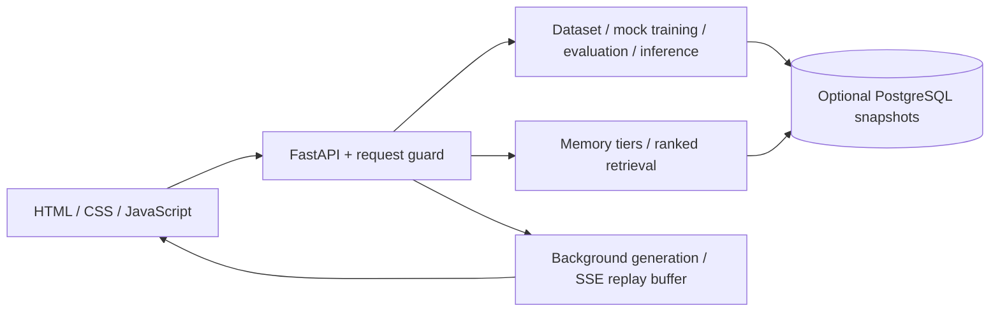

# ModelLab project guide

ModelLab lets developers inspect a small dataset → train → evaluate → inference workflow, explore memory ranking, and prove that stream replay loses no tokens. It addresses misleading model-demo metrics and fragile streaming connections. It is a teaching/developer lab, not a production model-serving platform.

## Architecture and data flow

| Location / technology | Responsibility |
| --- | --- |
| `app/api/` — FastAPI, Pydantic | HTTP contracts, validation, body/rate limits, security headers, docs |
| `app/training/pipeline.py` | Dataset cleaning/splitting, mock checkpoints, bounded model registry, evaluation and lookup inference |
| `app/memory/memos.py` | Working/episodic/semantic stores, deterministic 64-dimensional hash vectors, tenant-scoped ranking |
| `app/streaming/` — asyncio/SSE | Independent token generation, stable IDs, replay, cancellation, heartbeats, expiry |
| `app/persistence.py` — psycopg | Optional JSONB snapshots, startup restoration, rollback after failed writes |
| `app/frontend.py`, `app/templates/`, `app/static/` | Shared renderer, local fonts/logo, vanilla browser controls and semantic CSS |
| `app/run.py` — Uvicorn | Single-worker server; terminates open streams on shutdown |
| `scripts/build_frontend.py` | Generates static overview/workspace/404 plus assets in ignored `public/` |
| `tests/`, `.github/workflows/verify.yml` — pytest/Node | API, stores, persistence doubles, hardening, packaging and real socket tests; CI verification |

## Features and actual status

| Feature | How it works | Status / important limit |
| --- | --- | --- |
| Dataset and training | Cleans input/output rows; seed-42 shuffle; 80/20 split; records settings and writes three `.pt` files | Working workflow, **mock training**. Files contain text, not neural weights. `configs/lora.yaml` is reference only, not automatically read. |
| Evaluation and inference | Compares echoed base, prefixed prompt, and training-answer lookup; inference returns known answers or a labelled fallback | **Mock model behavior**. Scoring accepts case-insensitive answer containment/equality despite the API’s “exact-match” label. Cost, latency and memory figures are synthetic. |
| Memory | Working cap 20 per tenant; episodic notes; semantic similarity dedup; ranks importance × cosine relevance × age factor | Working local algorithm, **hash embeddings**, not an embedding model or vector database. Returns top matches even when score is zero. Compression joins short excerpts; not LLM summarization. |
| Streaming | Background task keeps generating after disconnect; reconnect replays after the last ID; final token count and SHA-256 check integrity | Working transport, **simulated tokens**. Finished streams expire after a fixed window; every restart loses streams. A model ID changes the simulation seed, not model inference. |
| Persistence | Datasets, models and memory snapshots stored/restored if `DATABASE_URL` is configured | Implemented optional PostgreSQL path; locally tested with database doubles, not a live database in this verification. |
| Pages | `/`, `/playground`, `/docs`, `/redoc`; HTML 404 recovery; `/openapi.json` describes API contracts | Available locally. Docs require CDN access; workspace does not. No login/account/billing system exists. |

## Maintenance boundaries

- Keep **one worker and one replica**, even with PostgreSQL: snapshots are not a multi-writer database design. Streams and rate counters are always transient.
- Without a database, all application stores reset on restart. With one, restored mock checkpoints are regenerated on disk.
- Tenant headers are public namespace selectors, not permissions. Datasets/models are shared; use sample data.
- Stores are bounded: oldest registry entries may disappear; replay cannot continue after expiry/restart. PostgreSQL failure does not silently switch to volatile storage.
- Local workflows passed; real GPU/PEFT training, external model calls, distributed execution and authenticated private storage are absent. Existing Starlette/httpx deprecation warning is non-failing.

See [the demo](DEMO_GUIDE.md) for observed results and [dependencies](API_DEPENDENCIES.md) for configuration. Preserve historical authors, font notices and dependency attribution; [CONTRIBUTING.md](../CONTRIBUTING.md) describes the maintainer workflow.
